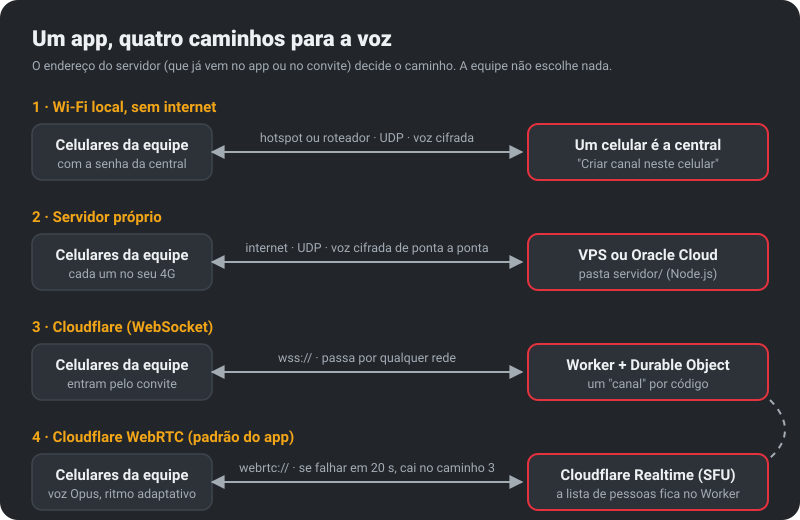
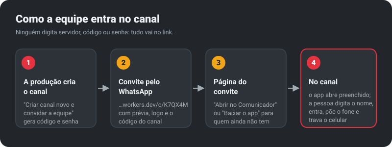
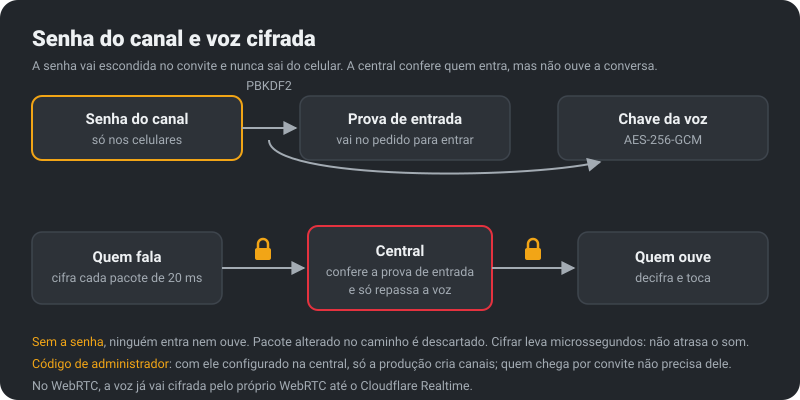

<p align="center"></p>

<p align="center"><b>Intercom de voz para a equipe de filmagem, no celular que todo mundo já carrega.</b><br>
Funciona com a tela travada, com fone Bluetooth ou botão PTT, com ou sem internet.</p>

<p align="center">
<a href="https://github.com/fernangcortes/comunicador/releases/latest/download/comunicador.apk"><b>Baixar o app (Android)</b></a> ·
<a href="LEIA-ME.md">Manual</a> ·
<a href="https://comunicador.escrevaprofernando.workers.dev">Central</a> ·
<a href="https://comunicador.escrevaprofernando.workers.dev/privacidade">Privacidade</a>
</p>

> **Estado:** versão em teste. O app compila e os servidores estão testados e no ar, mas o teste de campo com celulares de verdade ainda não foi feito.

## Para que serve

No set, a comunicação costuma passar por comunicadores dedicados, que são mais um equipamento para carregar, recarregar e distribuir. O Comunicador faz esse papel no celular: cada pessoa instala o app, entra no canal pelo convite do WhatsApp, põe o fone, trava a tela e fala quando precisa.

- **Três jeitos de falar:** um toque no botão do fone liga e desliga o microfone; o modo por voz transmite sozinho quando você fala; um botão PTT Bluetooth (compatível com Zello) dá o "segurou, falou".
- **Prioridade:** quando a direção ou a produção fala, as outras vozes abaixam.
- **Bipes de rádio** quando alguém começa e termina de falar.
- **Teste de áudio** de 3 segundos antes da diária.
- **Voz em Opus**: cerca de 25 MB de dados numa diária com 2 horas de fala.

## Como funciona



O app já vem configurado com a central na Cloudflare (caminho 4). Em locação sem sinal, um celular vira a central no Wi-Fi do set (caminho 1). Os caminhos 2 e 3 existem para quem quiser um servidor próprio ou uma rede que bloqueie o WebRTC.





## O que tem aqui

| Pasta | O que é |
|---|---|
| [`app/`](app/) | App Android (Kotlin, sem bibliotecas de interface; Android 8 ou mais novo) |
| [`cloudflare/`](cloudflare/) | Central na Cloudflare: Worker + Durable Object, páginas de convite, ponte para o Realtime (WebRTC) |
| [`servidor/`](servidor/) | Central para servidor próprio (VPS, Oracle), em Node.js sem dependências |
| [`marca/`](marca/) | Logo, ícones e o script que gera tudo |
| [`docs/`](docs/) | Os esquemas desta página |

O protocolo é o mesmo nas três centrais e está descrito no topo de [`Protocol.kt`](app/src/main/java/br/comunicador/set/Protocol.kt). A criptografia está em [`Seguranca.kt`](app/src/main/java/br/comunicador/set/Seguranca.kt).

## Gerar o APK

A cada envio para a branch `main`, o GitHub Actions roda os testes (app, servidor próprio e central da Cloudflare) e gera o APK. Uma etiqueta `v*` (ex.: `v0.9`) publica uma Release, e o link de download acima passa a entregar a versão nova.

No computador, com Java 17 e o Android SDK:

```bash
./gradlew testReleaseUnitTest assembleRelease
```

O APK de release é assinado com a chave definitiva, que fica fora do repositório (nos segredos do GitHub e no `gradle.properties` do usuário). Sem ela, o APK sai com a chave de teste do projeto e não instala por cima da versão publicada.

## Publicar a central na Cloudflare

Ver [`cloudflare/LEIA-ME.md`](cloudflare/LEIA-ME.md). Resumo: `npx wrangler deploy`, criar um app em Realtime → Serverless SFU e gravar `SFU_APP_ID`, `SFU_TOKEN` e (opcional) `ADMIN_CODE` com `npx wrangler secret put`.
